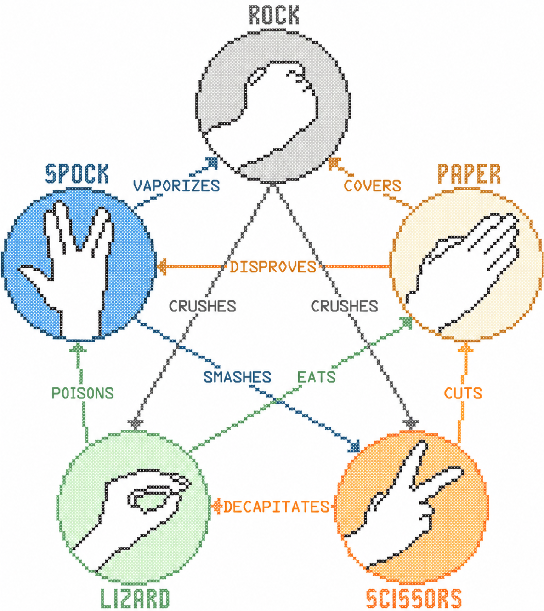

# אבן נייר, מספריים ולטאה? - התרגיל - חלק ג'
מקווים שמי שכתב את הקוד לפניכם שם לב להערה בתחתית ההסבר, אחרת... שיהיה בהצלחה.

המשיכו את הקוד שקיבלתם כך שיתקבל הפלט הנדרש.

באפשרותכם להוסיף ולממש כל מחלקה או פונקציה נוספת שיעזרו לכם להגיע לפתרון.


### הנחיות
- מוסיפים למשחק שני מהלכים: לטאה (`lizard`) וספוק (`spock`).
- כל מהלך מנצח שניים אחרים ומפסיד לשניים אחרים



| מהלך       | מנצח את              |
|------------|----------------------|
| `rock`     | `scissors`, `lizard` |
| `paper`    | `rock`, `spock`      |
| `scissors` | `paper`, `lizard`    |
| `lizard`   | `spock`, `paper`     |
| `spock`    | `scissors`, `rock`   |


- המשחק (`play()` ו-`score()`) והחוקים (`rules_for()`) צריכים לעבוד עם כל חמש הצורות.
- אסור שהתכנית תקרוס


סיימתם כש-`python main_c.py` מדפיס:

```text
rock: beats lizard, scissors | loses to paper, spock
spock: beats rock, scissors | loses to lizard, paper
lizard beats spock
spock beats rock
scissors beats lizard
Score: 2-1
```

#### שימו לב - על הקוד להיות קריא ככל הניתן, גנרי, ושומר על עקרונות הSOLID כך שכל אדם אחר שיסתכל על הקוד שלכם יוכל להבין אותו בקלות ולהרחיב אותו.